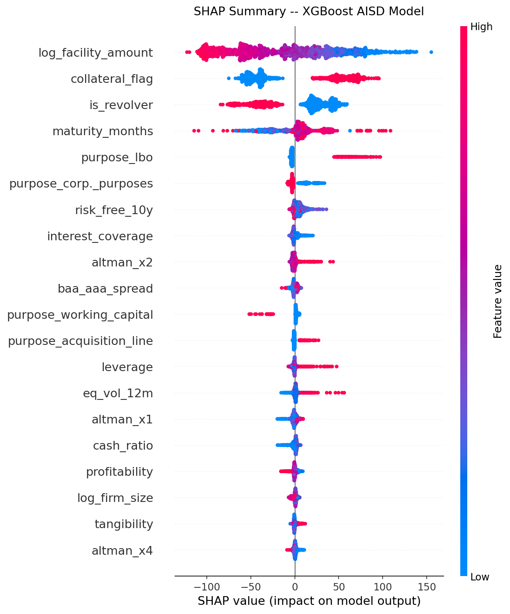

# Syndicated Loan Spread Prediction

> Predicting the all-in drawn spread (AISD) on syndicated loans using institutional-grade
> financial data, gradient-boosted trees, and rigorous no-lookahead feature engineering.
> XGBoost achieves **R² = 0.45** on a held-out 2020–2022 test set — a period the model
> never saw during training.

---

## ⚠ Data & Licensing Notice

**This repository contains code only.** All input datasets are licensed and are excluded
from version control by `.gitignore`.

| Dataset | Licence holder | How to obtain |
|---|---|---|
| LPC DealScan | Refinitiv / LPC via WRDS | University/institutional WRDS subscription |
| Compustat Fundamentals Annual | S&P Global via WRDS | University/institutional WRDS subscription |
| CRSP Monthly Stock File | CRSP via WRDS | University/institutional WRDS subscription |
| Chava-Roberts DealScan-Compustat Link | Michael Roberts (Wharton) | [Roberts' data page](https://finance.wharton.upenn.edu/~mrrobert/) |
| FRED macro series (BAA, AAA, GS10) | Federal Reserve | Public domain — fetched at runtime |

See [COMPLIANCE.md](COMPLIANCE.md) for a detailed breakdown of what is and is not permitted
to be shared publicly under the WRDS Subscriber Agreement.

---

## Project Overview

The spread a corporate borrower pays on a syndicated loan is a direct market price of credit
risk — incorporating the lender's assessment of default probability, information asymmetry, and
prevailing credit-cycle conditions. Accurate spread prediction has practical applications in:

- **Credit portfolio management** — pricing new facilities and marking existing ones to market
- **CLO structuring** — modelling the cost of debt across collateral pools
- **Distress early-warning** — detecting balance-sheet deterioration before covenant breaches

This project replicates and extends the empirical framework of Ivashina (2009) and Berg,
Saunders & Steffen (2016) using institutional WRDS data (DealScan + Compustat + CRSP),
demonstrating that non-linear gradient-boosted models capture spread-relevant interactions —
particularly between leverage, firm size, and macro credit conditions — that OLS benchmarks miss.

---

## Engineering Highlights

This section documents the non-obvious technical decisions for reviewers evaluating
the depth of the implementation.

### 1. Server-side SQL with SQLAlchemy 2.x compatibility
DealScan data is pulled via optimised server-side queries against the WRDS PostgreSQL cluster,
pushing all filtering (currency, spread range, date window) to the database before any data
is transferred over the network. The `DISTINCT ON (lpc_tranche_id)` clause deduplicates the
denormalised lender-share view to one row per facility on the database side.

WRDS 3.5 ships with SQLAlchemy 2.x, which removed the legacy `engine.execute()` interface.
Compatibility is achieved via:
```python
result = db.connection.execute(text(sql))
df = pd.DataFrame(result.fetchall(), columns=result.keys())
```
A cross-type join between the covenant subquery (numeric `packageid`) and the DealScan
view (varchar `lpc_deal_id`) is handled with an explicit `::text` cast to prevent a
`operator does not exist: numeric = character varying` error.

### 2. Facility-level entity resolution via Chava-Roberts
Borrower identities are resolved using the peer-reviewed Roberts (2008) linking table, which
maps DealScan `facilityid` → Compustat `gvkey` at the **facility level** (not deal or borrower
level). This matters because a single borrower may have multiple facilities with different
lenders and pricing.

Key implementation details:
- Links with confidence score < 0.5 are dropped; `NaN` scores denote manually verified links
  and are retained — filtering on `>= 0.5` alone would incorrectly discard the best-quality matches
- `gvkey` is zero-padded to 6 characters (`str.zfill(6)`) before cross-source joins to prevent
  silent mismatches between WRDS fields that vary in leading-zero convention

### 3. No-lookahead-bias enforcement
Every feature must be observable at the time the loan is priced. The as-of fiscal year merge
uses `pd.merge_asof(direction='backward')` to match each loan to the most-recent Compustat
annual report whose `datadate` falls **strictly before** `origination_date`:

```python
merged = pd.merge_asof(
    loans.sort_values("origination_date"),
    compustat.sort_values("fiscal_year_end"),
    left_on="origination_date",
    right_on="fiscal_year_end",
    by="gvkey",
    direction="backward",
)
```

A second guard filters out any rows where `fiscal_year_end >= origination_date` to handle
edge cases at period boundaries. All imputation medians and z-score scaler statistics are
computed exclusively on the training split before being applied to validation and test sets.

### 4. Winsorisation at training-set quantiles
All ratio features (leverage, profitability, Altman components, etc.) are winsorised at the
1st and 99th percentile of the **training distribution** — never the full sample — and the
clip bounds are stored and reapplied to unseen data:

```python
lo, hi = df_train[col].quantile([0.01, 0.99])
df[col] = df[col].clip(lo, hi)
```

This prevents outlier contamination of the feature space without deleting observations,
and ensures the test set is processed with statistics the model never "saw" during training.

### 5. Time-aware chronological split
Data is partitioned by `origination_date`, not randomly shuffled. Random shuffling would
leak future macro conditions (e.g., 2021 credit spreads) into the training set, inflating
apparent model performance. The split boundaries are chosen to isolate a genuine stress
period (2020–2022, including COVID) as the test set:

| Split | Period | Observations |
|---|---|---|
| Train | 2010–2016 | 7,841 |
| Validate | 2017–2019 | 2,268 |
| Test | 2020–2022 | 1,368 |

XGBoost early stopping is monitored on the validation set (50-round patience) to prevent
overfitting, but the validation set is never used for hyperparameter grid search, so it
remains an independent check on generalisation.

### 6. FRED macro via public CSV endpoint (no API key)
Monthly BAA, AAA, and 10-year Treasury yields are fetched at runtime from FRED's public
CSV endpoint, eliminating any dependency on API key management:

```python
url = f"https://fred.stlouisfed.org/graph/fredgraph.csv?id={series_id}"
```

The response is normalised with explicit column renaming (FRED CSV column names vary by
series), and numeric coercion with `errors='coerce'` handles the `"."` sentinel FRED uses
for missing observations.

### 7. SHAP explainability
`shap.TreeExplainer` is applied to the fitted XGBoost model on the held-out test set.
SHAP values additively decompose each prediction into per-feature contributions, providing
model-agnostic interpretability that satisfies both regulatory explainability requirements
and the intuition check that leverage should be the dominant spread driver.



---

## Model Architecture & Results

### Models trained
| Model | Description |
|---|---|
| OLS | statsmodels, HC3 heteroskedasticity-robust standard errors |
| Lasso | sklearn, alpha grid-searched on validation RMSE |
| Ridge | sklearn, alpha grid-searched on validation RMSE |
| XGBoost | Gradient-boosted trees, early stopping on validation set |

Missing values are median-imputed and features are z-score scaled using training-set
statistics only. Purpose dummies are one-hot encoded with no base-category drop (XGBoost
handles collinearity natively).

### Out-of-sample results (2020–2022 test set)

| Model | RMSE (bps) | MAE (bps) | R² |
|---|---|---|---|
| OLS | 158.46 | 114.10 | 0.370 |
| Lasso | 158.29 | 113.59 | 0.371 |
| Ridge | 158.46 | 114.19 | 0.370 |
| **XGBoost** | **148.24** | **104.48** | **0.448** |

XGBoost achieves a ~6% reduction in RMSE vs. OLS and R² = 0.45 on a period that includes
COVID-era credit stress — consistent with Berg, Saunders & Steffen (2016), who report R²
in the 0.40–0.55 range on similar data. The gap between XGBoost and linear models isolates
the contribution of non-linear leverage × macro interactions.

Machine-readable metrics: [`results/model_metrics.csv`](results/model_metrics.csv)

---

## Feature Set

| Category | Features |
|---|---|
| **Borrower — balance sheet** | `leverage`, `profitability`, `interest_coverage`, `log_firm_size`, `tangibility`, `cash_ratio` |
| **Borrower — distress signal** | `altman_z`, `altman_x1` (liquidity), `altman_x2` (retained earnings), `altman_x3` (EBIT/assets), `altman_x4` (equity/debt), `altman_x5` (asset turnover) |
| **Loan structural** | `log_facility_amount`, `maturity_months`, `collateral_flag`, `covenant_count`, `is_revolver` |
| **Loan purpose** | One-hot: Corp. purposes, Debt repay, Acquisition line, LBO, Working capital, Recapitalization, Other |
| **Market** | `eq_vol_12m` — rolling 12-month annualised equity return volatility (from CRSP) |
| **Macro** | `baa_aaa_spread` — BAA minus AAA yield in bps; `risk_free_10y` — 10-year Treasury (%) |

All ratio features are winsorised at the 1st/99th percentile of the training distribution.

---

## Data Sources

| Source | Fields used | Access |
|---|---|---|
| **WRDS DealScan** (`dealscan.dealscan`) | `all_in_spread_drawn_bps`, `tranche_amount`, `tranche_maturity_date`, `tranche_type`, `primary_purpose`, `secured`, covenant count | WRDS subscription |
| **WRDS Compustat** (`comp.funda`) | `at`, `dltt`, `dlc`, `ebitda`, `xint`, `sale`, `ppent`, `che`, `ceq`, `ni`, `wcap`, `re` | WRDS subscription |
| **WRDS CRSP** (`crsp.msf`, `crsp.ccmxpf_linktable`) | `ret`, `prc`, `shrout` (monthly); `gvkey`→`permno` link | WRDS subscription |
| **Chava-Roberts link** | `facilityid`→`gvkey` (facility-level, confidence-scored) | [Roberts' Wharton page](https://finance.wharton.upenn.edu/~mrrobert/) |
| **FRED** (`BAA`, `AAA`, `GS10`) | Monthly corporate bond yields and 10-year Treasury | Public — fetched at runtime |

---

## Project Structure

```
loan-spread-model/
├── src/
│   ├── wrds_download.py        Download DealScan / Compustat / CRSP from WRDS
│   ├── convert_chava_roberts.py Convert Chava-Roberts Excel link → CSV
│   ├── wrds_merge.py           Panel build: loans + financials + CRSP + FRED
│   ├── features.py             Feature engineering and winsorisation
│   ├── model.py                OLS / Lasso / Ridge / XGBoost training & evaluation
│   └── shap_analysis.py        SHAP explainability plots
├── case_studies/
│   └── toys_r_us.ipynb         Out-of-sample distress case study (SEC EDGAR data only)
├── notebooks/
│   └── eda.ipynb               Exploratory data analysis
├── sql/
│   └── extract.sql             Reference WRDS SQL queries
├── figures/                    SHAP plots (committed — model outputs, not data)
│   ├── shap_summary_beeswarm.png
│   ├── shap_summary_bar.png
│   ├── shap_pdp_leverage.png
│   └── shap_pdp_log_firm_size.png
├── results/
│   └── model_metrics.csv       Out-of-sample RMSE / MAE / R² (committed)
├── data/raw/                   ← gitignored; all raw and derived data files live here
│   └── .gitkeep                Directory marker only
├── COMPLIANCE.md               Data licensing and sharing policy
├── requirements.txt
└── README.md
```

---

## Running the Pipeline

### Prerequisites

```bash
pip install -r requirements.txt
```

WRDS access is required (university or institutional subscription covering DealScan,
Compustat, and CRSP). Contact your institution's library for access.

### Step 1 — Chava-Roberts link table

1. Download from [finance.wharton.upenn.edu/~mrrobert/](https://finance.wharton.upenn.edu/~mrrobert/)
   → Research → Data → DealScan-Compustat Linking Database
2. Save to `data/raw/ds-cs-link-post-202401.xlsx`
3. Convert:

```bash
python src/convert_chava_roberts.py
```

### Step 2 — Download WRDS data

```bash
python src/wrds_download.py
# Prompts for WRDS username and password
# Downloads ~4 files; CRSP monthly is the largest (~3M rows)
```

### Step 3 — Build panel, engineer features, train

```bash
python src/wrds_merge.py       # merges all sources → data/raw/panel.parquet
python src/features.py         # engineers features → data/raw/features.parquet
python src/model.py            # trains & evaluates all models
python src/shap_analysis.py    # generates SHAP figures → figures/
```

### Step 4 — Explore

```bash
jupyter lab
# Open notebooks/eda.ipynb or case_studies/toys_r_us.ipynb
```

---

## Case Study: Toys "R" Us

[`case_studies/toys_r_us.ipynb`](case_studies/toys_r_us.ipynb) applies the trained XGBoost
model to Toys R Us annual 10-K filings (2005–2016) fetched from SEC EDGAR. Toys R Us went
private in the 2005 KKR LBO and never appears in the training set, making this a genuine
out-of-sample test of generalisation.

The model predicts sharply rising spreads immediately following the LBO debt loading in 2005,
a temporary improvement during 2010–2014 as the credit cycle recovered, and a second
deterioration beginning in 2015 — two fiscal years before the September 2017 bankruptcy filing.
The Altman Z-score remains below the 1.81 distress threshold throughout the post-LBO period,
corroborating the model's persistently elevated spread predictions.

> Note: The case study uses only public SEC EDGAR data (CIK 0001005414) and FRED.
> No WRDS data is accessed or embedded in the notebook.

---

## References

- Ivashina, V. (2009). Asymmetric information effects on loan spreads. *Journal of Financial Economics*, 92(2), 300–319.
- Berg, T., Saunders, A., & Steffen, S. (2016). The total cost of corporate borrowing in the loan market. *Journal of Finance*, 71(3), 1357–1392.
- Chava, S., & Roberts, M. R. (2008). How does financing impact investment? The role of debt covenants. *Journal of Finance*, 63(5), 2085–2121.
- Altman, E. I. (1968). Financial ratios, discriminant analysis and the prediction of corporate bankruptcy. *Journal of Finance*, 23(4), 589–609.
- Lundberg, S. M., & Lee, S.-I. (2017). A unified approach to interpreting model predictions. *NeurIPS*, 30.
